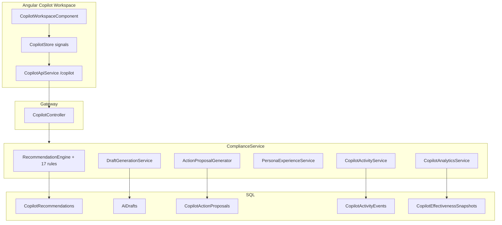

# AI Copilot Architecture

[← README](./README.md) · [Module spec](./module-specifications/copilot.md)

Sprint 13 implementation: deterministic recommendations, template drafts, approval framework, persona experience, observability.

---

## Status Summary

| Layer | Status |
|-------|--------|
| Core domain & APIs (13A) | **Complete** |
| Recommendation engine (13B) | **Complete** — 17 rules |
| Draft generation (13C) | **Complete** — 4 templates |
| Approval framework (13D) | **Complete** |
| Persona experience (13E) | **Complete** |
| Observability analytics (13F) | **Complete** |
| DB migration (13G) | **Complete** (2026-06-25) |
| LLM-native free-form agent | **Future** |

---

## Architecture Diagram

---

## Persona Router

| Persona | Enum value | Typical focus |
|---------|------------|---------------|
| Accreditation Coach | `AccreditationCoach` | Readiness, evidence, risk |
| Quality Manager Assistant | `QualityManagerAssistant` | Operations quality |
| Evidence Advisor | `EvidenceAdvisor` | Evidence gaps |
| CAPA Advisor | `CapaAdvisor` | Corrective actions |
| Executive Advisor | `ExecutiveAdvisor` | Executive briefing |
| Department Head Assistant | `DepartmentHeadAssistant` | Department workload |
| Auditor Assistant | `AuditorAssistant` | Audit prep |

**Auto resolution:** `CopilotPersonasController` + `pageContext=Copilot` on workspace load.

---

## Recommendation Engine

- **Input:** Operational SSOT reads (deficiencies, CAPA, SLA, evidence, snapshots) — no writes during generation.
- **Output:** `CopilotRecommendation` with severity, category, rationale JSON, deep links.
- **Rules registered in** `ComplianceService/Program.cs` (Accreditation×4, Deficiency×4, Capa×3, Sla×2, Evidence×2, Executive×3).
- **Refresh:** `POST /copilot/recommendations/refresh` triggers full rule engine for org/hospital.

---

## Draft Engine

| Template | DraftType |
|----------|-----------|
| CAPA Draft | `CapaDraft` |
| Executive Compliance Briefing | `ExecutiveComplianceBriefing` |
| Readiness Summary | `ReadinessSummary` |
| Evidence Checklist | `EvidenceChecklist` |

- Versioned drafts (`GroupId`, `Version`).
- `POST /copilot/drafts/generate`, `POST /copilot/drafts/{id}/regenerate`.

---

## Approval Framework

| Step | Endpoint |
|------|----------|
| Create proposal | `POST /copilot/proposals` or from-recommendation/draft |
| Approve | `POST /copilot/proposals/{id}/approve` |
| Reject | `POST /copilot/proposals/{id}/reject` |
| Execute | `POST /copilot/proposals/{id}/execute` |

`ProposalAuditEvent` records trail. Execution delegates to `ProposalExecutionService` — **only** path for Copilot-driven operational writes.

---

## Persona Experience Layer

- `GET /copilot/experience/catalog` — persona definitions, questions, themes.
- `GET /copilot/experience/workspace?persona=` — landing state, prioritized items.
- Workspace tabs: Overview, Recommendations, Drafts, Approvals, History, Analytics.

---

## Observability

| API | Purpose |
|-----|---------|
| `/copilot/analytics/overview` | Governance dashboard |
| `/copilot/analytics/trends` | Effectiveness trends |
| `/copilot/analytics/impact` | ROI / impact analysis |
| `/copilot/usage-metrics` | Engagement counts |
| `/copilot/activity` | Activity feed (GET/POST) |

`CopilotEffectivenessSnapshot` — daily aggregates (capture partially on-demand; scheduled job **planned** — TD-M02).

---

## Trust Model

1. **Read** SSOT → recommend → draft → propose.
2. **Human** approves proposal.
3. **Execute** applies bounded mutation with audit.

AI Orchestrator (`/api/v1/ai`) remains separate for conversational assist and workflows.

---

## Frontend

- Route: `/app/copilot`
- State: `CopilotStore` (`providedIn: 'root'`), signals only.
- API base: `/copilot` under `api/v1` (not double-prefixed).

---

## Technical Debt

See [Platform Technical Debt Register](../../ComplaincePlatform/docs/PlatformTechnicalDebtRegister.md) (TD-H01–H04, TD-M01–M05).

---

## Future LLM Integration

| Area | Vision |
|------|--------|
| Rationale enrichment | LLM explains rule output; rule still SSOT |
| Conversational Copilot | Merge sidebar AI with persona context bundles |
| Tool calling | Bounded tools mirroring proposal types |

**Not implemented** in Sprint 13.
