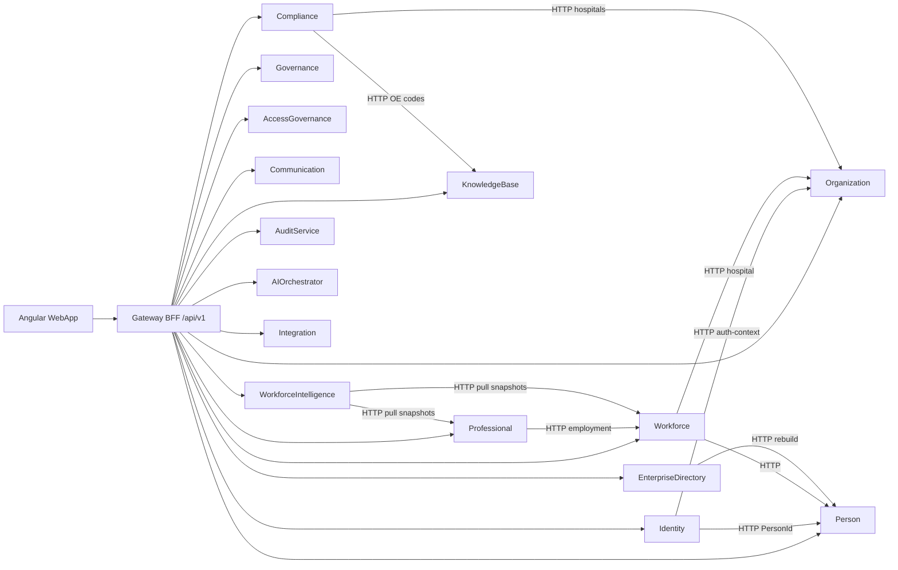
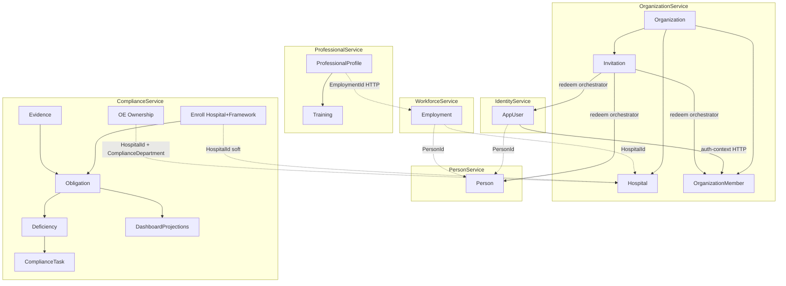

# AOVIAS Command — Platform-Wide Module Dependency Map

**Phase:** 1 — Discovery / context mapping  
**Status:** Authoritative for Phase 2 integrity audit scoping  
**Inspected:** 2026-08-31 against the AOVIAS.Cursor worktree  
**Scope:** Backend services, Gateway BFF, WebApp feature APIs  
**Code changes:** None (discovery only)

This document is the shareable export of the Phase 1 dependency map. Expected outcomes are taken from implementation, not product intent. Where the code does not establish a rule, the row is marked **UNKNOWN**.

**How to read this:** Cross-service links are almost entirely **soft GUIDs plus HTTP**, not database foreign keys. A column named `HospitalId` is not by itself a user-visible dependency. Observable impact exists only where a Gateway route, HTTP client, outbox consumer, Hangfire job, or UI actually reads that ID.

---

## Contents

1. [Dependency coverage summary](#dependency-coverage-summary)
2. [A. Platform module inventory](#a-platform-module-inventory)
3. [B. Cross-module dependency matrix](#b-cross-module-dependency-matrix)
4. [C. Entity relationship map](#c-entity-relationship-map)
5. [D. API propagation map](#d-api-propagation-map)
6. [E. Audit candidates](#e-audit-candidates)
7. [F. Unknowns / business rules requiring confirmation](#f-unknowns--business-rules-requiring-confirmation)
8. [Evidence index](#evidence-index)

---

## Dependency coverage summary

| Metric | Count |
| --- | ---: |
| Backend domains inspected | 20 |
| WebApp feature route modules (`routes.ts`) | 42 |
| DbSet entities inspected | ~320 |
| Gateway controller files | 68 (~95 route hosts) |
| Cross-module dependencies catalogued | 33 |
| Dependencies with verified downstream API path | 26 |
| Dependencies requiring further investigation | 7 (in matrix) + 22 audit candidates |
| Business-rule unknowns | 18 |

### Where entities live (DbSet counts)

| Store | DbSets | Notes |
| --- | ---: | --- |
| ComplianceService | 91 | Operational SoR for journey → dashboard |
| Identity spine combined | 101 | Identity + Organization + Person + AccessGovernance + EnterpriseDirectory + Communication |
| ProfessionalService | 25 | Includes Training subdomain |
| WorkforceIntelligence | 18 | Snapshots / caches, not live source |
| GovernanceService | 18 | Committees, approvals |
| WorkforceService | 16 | Employment aggregate |
| KnowledgeBase | 14 | Framework / node / assessment / gap |
| AIOrchestrator | ~20 | Drafts, identities, embeddings |
| IntegrationService | ~12 | Connectors, import/export |
| AuditService | ~5 | Legacy auditor model |



---

## A. Platform module inventory

Gateway is the BFF. WebApp calls `/api/v1` through MediatR handlers or thin `*V1ProxyController` classes (`IProxyService` / named HttpClients). YARP only covers leftover `/api/identity|{compliance}|ai` and is **not** the main WebApp path.

Training is **not** a separate microservice. It lives in `ProfessionalDbContext` and is exposed as Gateway `/training`.

### Service catalog

| Service | Class | Principal data | Gateway surface | WebApp features |
| --- | --- | --- | --- | --- |
| IdentityService | Primary | AppUser, sessions, MFA, security events | `/identity`, `/security` | identity-admin, security, account |
| OrganizationService | Primary / master | Org, Hospital, Member, Invitation, License, OU, Settings | `/hospitals`, `/membership`, `/invitations`, `/licenses`, `/settings` | organization, workforce-admin, settings, commercial-admin |
| PersonService | Primary / master | Person + contacts/addresses/docs | `/persons` | persons |
| WorkforceService | Primary | Employment, Position, Transfer, Promotion | `/employment` | workforce |
| ProfessionalService | Primary | ProfessionalProfile + Training subdomain | `/professional-profiles`, `/training` | professional, training |
| WorkforceIntelligence | Reporting / snapshot | Snapshots, matrices, caches | `/intelligence` | workforce-intelligence (under teams) |
| AccessGovernance | Supporting / admin | Roles, policies, assignments, delegations | `/roles`, `/policies`, `/authorization` | access-governance |
| GovernanceService | Primary | Committees, approvals, responsibilities | `/committees`, `/governance`, `/approval-chains` | governance |
| EnterpriseDirectory | Reporting / index | DirectoryIndex (denormalized) | `/directory` | enterprise-directory |
| CommunicationService | Supporting | Notifications, templates, campaigns | `/notifications`, `/communication` | communication, notifications |
| ComplianceService | Primary | 91 DbSets: journey → dashboard | `/journeys`, `/evidence`, `/tasks`, `/findings`, `/deficiencies`, `/copilot`, `/dashboard`, … | journey, evidence, tasks, audit, copilot, dashboard, … |
| KnowledgeBase | Shared / master | Framework, Node, Assessment, Gap | `/knowledge-base` | frameworks, gap-analysis, journey KB |
| AuditService | Supporting / legacy | Legacy audit sessions/findings | `/audit` | audit (partial) |
| AIOrchestrator | Supporting / AI | Drafts, identities, embeddings | `/ai`, `/ai/profiles` | copilot, ai-identity, control-center AI |
| IntegrationService | Admin | Connectors, sync, import/export | `/integration` | integration |
| Gateway | BFF | MediatR + HttpClient façade; YARP residual | `api/v1/*` | all WebApp |

### Classification

| Class | Modules |
| --- | --- |
| **Primary / business** | Identity, Organization, Person, Workforce, Professional (incl. Training), Compliance (Journey, Evidence, Tasks, Findings, Deficiencies, SLA, CAPA, Maturity, Copilot, Control Center, Documentation, Risks, Quality, Patient Safety), Governance, KnowledgeBase assessments |
| **Supporting** | AccessGovernance, Communication, AuditService, AIOrchestrator |
| **Master / shared** | Frameworks catalog, lookups, org units (**split department stores**) |
| **Reporting / read model** | DashboardProjections, AnalyticsDailySnapshots, WI snapshots, Reporting, Compliance Graph, DirectoryIndex |
| **Admin / config** | Settings, Commercial/Licenses, Setup, Security, AI Identity, Integration |

---

## B. Cross-module dependency matrix

Legend:

- **Verified API** = downstream HTTP/Gateway path traced in code
- **Needs investigation** = relationship or listener exists, but mutation/publish/cascade is missing or unclear
- **UNKNOWN** = intended user-visible behavior cannot be established from code

### Identity / organization / person spine

| Source | Entity | Operation | Target | API | Expected impact | Evidence | Verified |
| --- | --- | --- | --- | --- | --- | --- | --- |
| Identity | AppUser | Register / create | Person | `POST /internal/persons` (Identity→Person); Gateway `POST /identity/self-register`, `POST /identity/users` | New `AppUser.PersonId` when `RegistrationService.CreatePersonForRegistrationAsync` runs | `RegistrationService` + `PersonServiceClient` | Yes |
| Identity | AppUser | Login | OrganizationMember claims | `GET /internal/users/{userId}/auth-context` | JWT org/hospital/role from **Active** membership; empty claims if none | `TokenService` + `OrganizationServiceClient.GetUserAuthContextAsync` | Yes |
| Organization | OrganizationMemberInvitation | Redeem | Identity + Person + Membership + License | `POST /api/v1/invitations/redeem` | `InvitationRedeemOrchestrator` provisions user, person, membership, optional seat | Gateway `InvitationRedeemOrchestrator` | Yes |
| Onboarding | Signup / onboard wizard | Create | Identity + Organization + Compliance + KB | `POST /onboarding/signup`, `POST /onboarding/onboard` | Hospital wizard-profile, KB frameworks, enroll + journeys + obligation assessment, identity or invitations | `OnboardWizardCommandHandler` | Yes |
| Person | Person | Create | DirectoryIndex | Outbox `PersonCreated` (mark-only); Directory rebuild `GET /api/v1/persons` | Directory does **not** event-consume `PersonCreated`; freshness via `POST /directory/rebuild` or scheduler | `PersonAppService.CreateAsync`; `DirectoryIndexProjector` | Yes |
| Person | Person | Update | Directory / Membership denorm | `PUT /persons/{id}`; no `PersonUpdated` writer found | **UNKNOWN** — Directory registers `PersonUpdated` but PersonService does not publish it; member FirstName/Email not synced | `PersonAppService`; EnterpriseDirectory `ServiceCollectionExtensions` | No |
| Person | Person | Soft-delete | Identity / Membership / Comm / Directory | `DELETE /persons/{id}` | **UNKNOWN** — SoftDelete only; no outbox; no cascade to AppUser/membership/directory/comm | `PersonAppService.DeleteAsync` | No |
| Organization | OrganizationMember | Create / transfer / status | Identity JWT | `POST/PUT /membership`, `POST /membership/transfer`; GET auth-context | Next login/token refresh reflects Active membership; inactive excluded | `InternalOrganizationController.GetUserAuthContext` | Yes |
| Organization | LicenseSeatAssignment | Assign / suspend | Gateway entitlements | `POST /licenses/*/seats`; `LicenseEntitlementMiddleware` | Org feature access changes on seat/license status | `LicensesController` + `LicenseEntitlementMiddleware` | Yes |
| AccessGovernance | RoleAssignment | Assign / revoke | Authorization evaluate | `POST /role-assignments`; `GET /authorization/evaluate` | Evaluate/effective-permissions change after persist; AG outbox is mark-only | `AccessGovernanceAppServices` | Yes |
| Identity | AppUser.Status | Suspend / disable | AG / seats / membership | `POST /identity/users/{id}/suspend\|disable`; commercial-admin user actions | Login blocked. Cascade revoke of roles/seats/memberships: **UNKNOWN** | `IdentityUsersController` | No |
| Communication | InAppNotification | Deliver | Person | `GET /internal/users/{userId}/contact` → PersonId | Notifications require PersonId; users without PersonId have no in-app path | `IdentityPersonClient` + `CommunicationClients` | Yes |

### Workforce / professional / intelligence

| Source | Entity | Operation | Target | API | Expected impact | Evidence | Verified |
| --- | --- | --- | --- | --- | --- | --- | --- |
| Workforce | Employment | Create | Person + Hospital | `POST /employment`; `GET /internal/persons/{id}`; `GET /internal/hospitals/{id}` | Create fails if Person or Hospital HTTP lookup fails; outbox `EmploymentCreated` (not published) | `EmploymentAppService.CreateAsync` + `WorkforceClients` | Yes |
| Workforce | Employment | Transfer | Professional / WI | `POST /employment/{id}/transfer` | Employment org/hospital update + `TransferRecord`. ProfessionalProfile **not** updated. WI waits for snapshot/refresh | `EmploymentAppService.TransferAsync` | Yes |
| Workforce | Employment | Promote | Position + WI | `POST /employment/{id}/promote` | `AssignPosition` + `PromotionRecord` + outbox `EmploymentPromoted` (WI does not register that event) | `EmploymentAppService.PromoteAsync`; WI `ServiceCollectionExtensions` | Yes |
| Workforce | Employment | Soft-delete | WI / Directory | `DELETE /employment/{id}` | SoftDelete, no outbox. WI/Directory listen for `EmploymentTerminated` which is **never written** | `EmploymentAppService.DeleteAsync` | No |
| Professional | ProfessionalProfile | Create | Workforce | `POST /professional-profiles`; `GET /internal/employment/{id}` | Create validates employment exists; outbox `ProfessionalProfileCreated` (WI not subscribed) | `ProfessionalProfileAppService.CreateAsync` | Yes |
| Professional | TrainingSession / Attendance | Create / complete | WI training matrix | `POST /training/sessions`, attendances; live `GET /training/programs/matrix` | Professional training matrix is live EF. WI training dashboard is snapshot until `POST /intelligence/refresh` or ~60 min job. Phase-4 attendance has no outbox | `TrainingAppService` vs `IntelligenceQueryService` | Yes |
| Organization | Department / OU | Create / deactivate | Workforce / Training / OE ownership | `POST /departments`, `/organizational-units`; `GET /departments/tree` | Split department models. OE upsert uses Compliance Departments, not Org OUs. Mapping consistency **UNKNOWN** | Organization Phase4 vs `ObjectiveElementOwnershipAppService` | No |
| WI | WorkforceSnapshot | Refresh (derived) | Workforce + Professional + Governance + Org | `POST /intelligence/refresh`; GET employment, professional-profiles, governance analytics summary, departments/tree | Dashboards read WI DB snapshots/cache, not live source tables | `WorkforceSnapshotService.RefreshOrganizationAsync` | Yes |

### Compliance / KnowledgeBase / governance

| Source | Entity | Operation | Target | API | Expected impact | Evidence | Verified |
| --- | --- | --- | --- | --- | --- | --- | --- |
| Organization | Hospital | Create | OE Ownership / Journey | `POST /hospitals`; `GET /hospitals/{id}/oe-ownership` | Matrix is parameterized by `hospitalId`; lists CS **catalog** OEs even without enrollment. `JourneyStatus` only if `ComplianceJourney` exists. Hospital existence not HTTP-validated at enroll | `ObjectiveElementOwnershipAppService.ListMatrixAsync`; `EnrollHospitalInFrameworkCommandHandler` | Yes |
| Compliance | Hospital + Framework enrollment | Create | Obligations | `POST /hospitals/{hospitalId}/frameworks/{frameworkId}/enroll` | `SyncForOrganizationAsync` creates one obligation per local ObjectiveElement; `ComplianceNodeId` always null | `EnrollHospitalInFrameworkCommandHandler` + `ObligationSynchronizationService` | Yes |
| Onboarding / KB | Assessment | Apply | Obligations + Deficiencies + Maturity | `POST /onboarding/onboard`; `POST /deficiencies/bootstrap-from-onboarding`; KB assessments | `OnboardingObligationAssessmentService` (+ KB node→code map) → `ObligationProjectionService` → deficiencies + stage unlock | those services | Yes |
| Compliance | Deficiency | Identify (event) | Tasks | Outbox `DeficiencyIdentified` → `EnsureRemediationTaskAsync` | Remediation task created when event is processed in-process | `InProcessOutboxProcessor` + `IDeficiencyRemediationTaskService` | Yes |
| Compliance | Evidence | Upload / review | Obligation + Dashboard | `POST /evidence`; evidence-binder | ObligationProjection rerun; incremental dashboard if `EvidenceUploaded` candidate fires | `ObligationProjectionService`; `DashboardProjectionUpdater` | Yes |
| Compliance | Finding | Promote | Deficiency + CAPA | `POST /findings/{id}/promote`; CAPA APIs | Finding promote creates/links deficiency; CAPA can source from finding | `FindingsV1ProxyController` + Finding domain | Yes |
| Compliance | OE Ownership | Upsert / clear | Notifications + Tasks (template) | `PUT/DELETE /hospitals/{id}/oe-ownership/{oeId}` | Persists CS ownership (`ComplianceDepartment` + `PrimaryOwnerUserId`). Does not call Org HTTP. Notification mapping exists for `OeOwnershipAssigned` | `ObjectiveElementOwnershipAppService`; `CommunicationComplianceNotificationPublisher` | Yes |
| Compliance | Obligation status / score | Derived update | Dashboard + Analytics + Maturity | `GET /dashboard`; `/analytics`; `/compliance-maturity/dashboard` | Full rebuild on score/state/enroll/obligation events; Hangfire nightly snapshots; incremental for task/finding/deficiency/evidence | `DashboardProjectionEngine`; Hangfire in Compliance `Program.cs` | Yes |
| KnowledgeBase | GapAnalysisReport | Create | Copilot / Gap UI | `POST /knowledge-base/assessments/{id}/gap-analysis` | Persisted in KB; Journey/gap-analysis screens consume; Copilot can read `GapAnalysisResult` | `KnowledgeBaseController`; `gap-analysis-api.service.ts` | Yes |
| Governance | CommitteeDecision | Create | Compliance IDs | `POST /committees/.../decisions` | Soft ID links (`DeficiencyId`, `RiskId`, `TaskId`); no FK. WI listens for `CommitteeDecisionRecorded` if bus delivers | Governance entities; WI projection list | Yes |

### Cross-cut

| Source | Entity | Operation | Target | API | Expected impact | Evidence | Verified |
| --- | --- | --- | --- | --- | --- | --- | --- |
| AuditService | AuditSession / AuditFinding | CRUD | Compliance Auditor | Gateway `/audit` vs `/auditor` | Two auditor models. Dual source of truth until Phase 2 confirms which UI path writes | `AuditDbContext` vs Compliance `Domain.Auditor` | No |
| AIOrchestrator | Drafts / ACE | Assist | Compliance Copilot | Gateway `/ai/*`; Compliance `IAiOrchestratorAssistClient` | Copilot/docs AI paths HTTP to AIOrchestrator; KB RAG embeddings are separate from Compliance OE-code bridge | Compliance `Program.cs` HTTP clients; AIOrchestrator `KnowledgeBaseClient` | Yes |
| Integration | Import/Export / webhooks | Write | Platform write client | `POST /integration/*` | `PlatformWriteClient` can mutate platform entities; per-connector mapping needs Phase 2 case review | `IntegrationService` `PlatformWriteClient` | No |

---

## C. Entity relationship map

In-DB navigations exist only **inside** a service. Across services, names like `HospitalId` are application-level IDs.

### Identity spine

```text
AppUser
 ├── PersonId? ──soft──► Person (PersonService)
 ├── sessions / MFA / security events
 └── login ──HTTP──► OrganizationMember auth-context
Organization
 ├── Hospital (EF Restrict)
 ├── OrganizationMember (UserId, PersonId?, HospitalId?, EmploymentId? soft)
 ├── OrganizationMemberInvitation → redeem orchestrates Identity+Person+Member+Seat
 ├── LicenseKey / SeatAssignment.UserId
 └── Settings, OU tree, subscriptions
Person
 ├── contacts, addresses, documents (EF)
 └── no OrganizationId column
AccessGovernance.RoleAssignment ──soft──► UserId, OrganizationId, HospitalId, EmploymentId
DirectoryIndex ──denorm──► PersonId, EmploymentId, OrganizationId (rebuild/HTTP)
CommunicationProfile ──soft──► PersonId
```

### Workforce / professional

```text
Employment
 ├── PersonId, OrganizationId, HospitalId, UserId? (soft)
 ├── PositionAssignment, DepartmentAssignment (MasterDepartmentId), ReportingRelationship (EF)
 ├── TransferRecord / PromotionRecord
 └── does not create ProfessionalProfile
ProfessionalProfile
 ├── PersonId unique, EmploymentId, OrganizationId?, HospitalId? (soft)
 ├── credentials / privileges (EF)
 └── TrainingProgram / Session / Attendance (same DbContext)
WorkforceIntelligence snapshots ──HTTP pull──► employment, profiles, governance summary, dept tree
```

### Compliance operational graph

```text
HospitalId + FrameworkId (soft, not Org FK)
 └── enroll → OrganizationComplianceObligation per local ObjectiveElement
      └── ObligationProjection → status / readiness / deficiencies / maturity stages
           ├── DeficiencyIdentified → ComplianceTask (SourceDeficiencyId)
           ├── Evidence → ObjectiveElementEvidence → obligation re-project
           ├── Finding → PromotedDeficiencyId → Capa.SourceFindingId
           ├── SLA / escalation jobs
           ├── ComplianceSnapshot / AnalyticsDailySnapshot (Hangfire)
           └── DashboardProjections (outbox full vs incremental)
ObjectiveElementOwnership (hospital-scoped)
 ├── ObjectiveElement (local catalog)
 ├── ComplianceDepartment (local, not Org OU)
 └── PrimaryOwnerUserId (string)
KnowledgeBase.ComplianceNode ──HTTP OE codes only──► onboarding assessment map
Governance.CommitteeDecision ──soft──► DeficiencyId / RiskId / TaskId
```



---

## D. API propagation map

### 1. Invitation redeem (full spine write)

```text
WebApp invitations UI / accept page
  → POST /api/v1/invitations/redeem
  → InvitationRedeemOrchestrator
  → Identity POST /internal/users/register
  → Person POST /internal/persons (create or upsert)
  → Organization membership + optional license seat
  → Observable: user can log in; auth-context returns membership; invitations list shows redeemed
```

### 2. Enroll hospital in framework

```text
UI journey / frameworks
  → POST /api/v1/hospitals/{id}/frameworks/{fw}/enroll
  → EnrollHospitalInFrameworkCommandHandler
  → ObligationSynchronizationService
  → GET /journey/obligations shows new rows
  → OE ownership GET still lists catalog OEs; JourneyStatus fills after journey create
  → Dashboard rebuild on enroll/state events
Hospital create in Organization does not by itself create obligations or ownership rows.
```

### 3. Create employment

```text
Gateway POST /employment
  → EmploymentAppService validates Person + Hospital via HTTP
  → persist + EmploymentCreated outbox (WorkforceOutboxProcessor marks ProcessedOn only)
  → Professional profile remains absent until POST /professional-profiles
  → WI headcount changes after snapshot refresh (~60 min or POST /intelligence/refresh), not immediately via bus
```

### 4. OE ownership upsert

```text
Organization OE matrix UI
  → PUT /api/v1/hospitals/{id}/oe-ownership
  → Gateway OeOwnershipController + OeOwnershipProxyHandlers
  → Compliance OeOwnershipController
  → ObjectiveElementOwnershipAppService
       validates local OE+framework and ComplianceDepartment.IsActive
       does not query OrganizationService
  → Notification publisher maps OeOwnershipAssigned → task-assigned template
Department tree on org screens is a different API: GET /departments/tree
```

Frontend: `WebApp/src/app/features/organization/services/oe-ownership-api.service.ts`  
Backend: `ComplaincePlatform/ComplianceService/Application/Services/ObjectiveElementOwnershipAppService.cs`

### 5. Compliance mutation chain (enroll → dashboard)

```text
POST enroll
  → OrganizationComplianceObligation per local OE (ComplianceNodeId = null)
Onboarding / assessment apply
  → ObligationProjectionService
  → ObligationStatusUpdatedDomainEvent
  → EvaluateObligationDeficiencies → ComplianceDeficiency (+ DeficiencyIdentified)
  → StageUnlockingService → OrganizationMaturityStageState
DeficiencyIdentified (in-process outbox)
  → EnsureRemediationTaskAsync → ComplianceTask.SourceDeficiencyId
Task / Evidence / Finding promote / CAPA / SLA jobs
  → projection + Hangfire snapshots
  → DashboardProjectionEngine (full rebuild vs incremental)
```

Identity/Workforce/Person outbox processors **log then mark `ProcessedOn`**. They do not publish to Service Bus. Compliance `InProcessOutboxProcessor` is the exception that drives dashboard projection and deficiency → task.

---

## E. Audit candidates

These are Phase 2 test targets, **not** confirmed product defects unless the code already proves a missing publisher or dual store.

| # | Candidate | Why Phase 2 should exercise it |
| ---: | --- | --- |
| 1 | Person update/delete → Directory stale | Directory registers `PersonUpdated`; Person writes only `PersonCreated`; delete has no outbox |
| 2 | Outbox processors mark-only | `IdentityOutboxProcessor` logs then sets `ProcessedOn` with no bus publish. Same pattern in Person / AG / Workforce / Professional / WI |
| 3 | Organization outbox without consumer | `MembershipCreated` / `Transferred` written; no Org `OutboxProcessor` hosted service found |
| 4 | `EmploymentTerminated` never emitted | WI and Directory handle it; `DeleteAsync` only SoftDelete |
| 5 | `EmploymentPromoted` / `ProfessionalProfileCreated` unused by WI | Events written; WI projection list omits them |
| 6 | Empty outbox payloads | Many events persist `"{}"`; snapshot refresh skips without `organizationId` |
| 7 | Transfer does not update ProfessionalProfile | Employment org/hospital can drift from profile |
| 8 | Training Phase-4 has no outbox | WI training matrix stale until snapshot refresh; live matrix is ProfessionalService only |
| 9 | OE matrix lists catalog OEs, not enrolled OEs | `ListMatrixAsync` joins all `ObjectiveElements`; `JourneyStatus` only if journey exists |
| 10 | OE department is ComplianceDepartment | Org OU / `MasterDepartmentId` are different stores; upsert rejects inactive CS department |
| 11 | Enrollment does not set `ComplianceNodeId` | `ObligationSynchronizationService` always null — KB node bridge incomplete |
| 12 | Hospital not HTTP-validated at enroll | `EnrollHospitalInFrameworkCommandHandler` comments hospital existence not fully validated |
| 13 | KB framework GUID fallback | `KnowledgeBaseServiceClient` may merge all frameworks' OE codes on miss |
| 14 | Dashboard incremental filter narrow | Maturity unlock, SLA chase, CAPA, docs, incidents may not invalidate `DashboardProjections` |
| 15 | Dual auditor models | `AuditService` vs ComplianceService `Domain.Auditor` |
| 16 | Tenant filter incomplete | Tasks, Evidence, Risks, Capas, Snapshots, DashboardProjections rely on app-layer scoping |
| 17 | Denormalized OrganizationMember profile | FirstName/Email not updated from Person |
| 18 | User disable cascade UNKNOWN | No RoleAssignment/seat/membership revoke found on suspend |
| 19 | Directory `Person?organizationId` | Person entity has no `OrganizationId`; directory list filter may be incomplete |
| 20 | FE double-prefix risk | workforce-intelligence, integration, administration-audit API services may call `/api/v1/api/v1/...` |
| 21 | Employment UI vs Gateway | `EmploymentApiService` has no create/delete/assign while Gateway exposes them |
| 22 | Cert expiry reminders trapped | Professional `CertificationExpiryReminderHostedService` writes outbox only |

---

## F. Unknowns / business rules requiring confirmation

| ID | Question |
| --- | --- |
| U1 | Should admin user-create always create a Person? |
| U2 | Should Person update/delete refresh DirectoryIndex and OrganizationMember denormalized names without a rebuild? |
| U3 | Should user suspend/disable revoke RoleAssignments, license seats, and memberships? |
| U4 | Should membership archive release license seats? |
| U5 | Should employment delete emit `EmploymentTerminated` and deactivate directory/WI rows immediately? |
| U6 | Should transfer/promote update ProfessionalProfile org/hospital and refresh WI? |
| U7 | Should Phase-4 training completion feed WI and Communication the same way as legacy `TrainingCompleted`? |
| U8 | Which department master is canonical: Org OU, `MasterDepartmentId`, or `ComplianceDepartment`? |
| U9 | Should OE ownership matrix list only enrolled framework OEs for that hospital? |
| U10 | Should enroll validate Hospital against OrganizationService and set `ComplianceNodeId` from KB? |
| U11 | Which auditor stack is product: AuditService or Compliance `Domain.Auditor`? |
| U12 | When is `DashboardProjectionEngine` expected to refresh for SLA/CAPA/docs/incidents/maturity unlock? |
| U13 | Is `OutboxRelayWorker` supposed to publish Identity/Workforce/Person events, or only Compliance? |
| U14 | Should users without PersonId receive notifications? |
| U15 | Is Designation an Org membership string only, or a missing Workforce entity? |
| U16 | Does Integration import honor the same validation as UI create paths? |
| U17 | Are dual membership APIs (`organization-members` vs `/membership`) both still in product use? |
| U18 | KB `GapAnalysisReport.FacilityId` vs Compliance `HospitalId` — same identifier? |

Highest leverage for Phase 2 scoping: U2, U3, U5, U6, U8, U9, U11, U13.

---

## Evidence index

| Area | Path |
| --- | --- |
| Identity outbox (mark-only) | `ComplaincePlatform/IdentityService/Infrastructure/Background/IdentityOutboxProcessor.cs` |
| Person create/delete | `ComplaincePlatform/PersonService/Application/Services/PersonAppService.cs` |
| Org auth-context | `ComplaincePlatform/OrganizationService/Controllers/Internal/InternalOrganizationController.cs` |
| Invitation redeem | Gateway `InvitationRedeemOrchestrator` |
| OE ownership API | `ComplaincePlatform/ComplianceService/Controllers/V1/OeOwnershipController.cs` |
| OE ownership service | `ComplaincePlatform/ComplianceService/Application/Services/ObjectiveElementOwnershipAppService.cs` |
| OE ownership Gateway | `ComplaincePlatform/Gateway/Controllers/OeOwnershipController.cs`, `.../Handlers/OeOwnershipProxyHandlers.cs` |
| OE ownership UI | `WebApp/src/app/features/organization/services/oe-ownership-api.service.ts` |
| Enroll | `ComplaincePlatform/ComplianceService/Application/Services/EnrollHospitalInFrameworkCommandHandler.cs` |
| Employment | `ComplaincePlatform/WorkforceService/Application/Services/EmploymentAppService.cs` |
| Workforce HTTP clients | `ComplaincePlatform/WorkforceService/Infrastructure/Clients/WorkforceClients.cs` |
| WI snapshots | `ComplaincePlatform/WorkforceIntelligenceService` snapshot + `SourceServiceClients.cs` |
| Directory event registration | `ComplaincePlatform/EnterpriseDirectoryService/Extensions/ServiceCollectionExtensions.cs` |
| Compliance DbContext | `ComplaincePlatform/ComplianceService/Infrastructure/Persistence/ComplianceDbContext.cs` |
| Gateway HTTP clients | `ComplaincePlatform/Gateway/Extensions/ServiceCollectionExtensions.cs` (`AddBackendHttpClients`) |
| WebApp features | `WebApp/src/app/features/*/routes.ts` |

### Suggested Phase 2 first scenarios

1. Invitation redeem → login + auth-context + membership list  
2. Enroll hospital in framework → obligations + dashboard  
3. OE ownership upsert → matrix GET + department mismatch vs Org tree  
4. Employment transfer/delete → ProfessionalProfile + WI snapshot lag  
5. Person update → Directory and OrganizationMember names  
6. Obligation/deficiency change → dashboard projection freshness  

---

*End of Phase 1 dependency map. Use this file as the shared brief for Phase 2 API/screen verification.*
