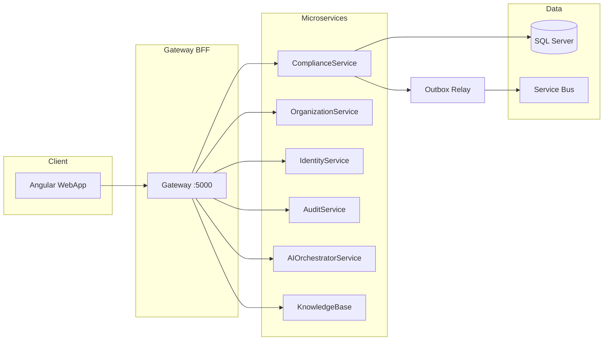

# PRAMAN Master Architecture & Product Blueprint

**Version:** 1.0  
**Status:** Authoritative reference (generated from codebase analysis, June 2026)  
**Constitution:** [PRAMAN Architecture Constitution](../PRAMAN-Architecture-Constitution.md) takes precedence over this blueprint where they conflict.

---

## What is PRAMAN?

PRAMAN is an **enterprise Healthcare Compliance Operating System** — a multi-tenant platform that helps hospitals and healthcare organizations achieve and sustain accreditation readiness (NABH-first), govern compliance execution, manage evidence, deficiencies, CAPA, SLA, and analytics, with an AI Copilot that recommends actions but never auto-executes without human approval.

**Product name in UI:** PRAMAN — Healthcare Compliance Command Platform  
**Operator portal:** Angular SPA (`WebApp`)  
**API boundary:** Gateway BFF (`http://localhost:5000/api/v1` in development)

---

## Vision

Move from “NABH compliance tool” to **Always Audit Ready** healthcare compliance OS — traceable, persona-driven, evidence-backed, with deterministic AI assistance and human-in-the-loop approvals.

---

## Technology Stack

| Layer | Technology |
|-------|------------|
| Backend | .NET 10, ASP.NET Core, EF Core 10, MediatR, Hangfire |
| API | REST `api/v1`, Gateway BFF + named HttpClients |
| Auth | JWT + scopes (`compliance.api`, `organization.api`, etc.) |
| Events | Transactional outbox → Azure Service Bus (`OutboxRelayWorker`) |
| Frontend | Angular 21, standalone components, signals (no NgRx) |
| UI | Material, Tailwind, CSS design tokens (`theme.tokens.css`) |
| Data | SQL Server (per-service databases in dev) |
| AI | AIOrchestratorService + Compliance Copilot (deterministic rules + templates) |

---

## Architecture Summary

---

## Current Version & Maturity

| Dimension | Assessment |
|-----------|------------|
| **Platform version** | 1.0 (pre-production hardening) |
| **Sprints delivered** | Sprint 1–13 (Copilot through 13F + migration 13G) |
| **Production readiness** | **Partial** — core journey, evidence, findings, deficiencies, SLA, analytics foundation, Copilot workspace operational in dev; external audit workspace, policy, incident modules not implemented |
| **Documentation maturity** | This blueprint v1.0 |

See [26-Current-Development-Stage.md](./26-Current-Development-Stage.md) and [05-Module-Readiness-Matrix.md](./05-Module-Readiness-Matrix.md).

---

## Documentation Navigation

### Executive & Product

| Doc | Purpose |
|-----|---------|
| [01-Executive-Summary.md](./01-Executive-Summary.md) | Mission, market, differentiators |
| [02-Product-Vision.md](./02-Product-Vision.md) | Problems, goals, principles |
| [03-Business-Architecture.md](./03-Business-Architecture.md) | Bounded contexts |
| [04-Module-Catalog.md](./04-Module-Catalog.md) | Module index |
| [05-Module-Readiness-Matrix.md](./05-Module-Readiness-Matrix.md) | Readiness scores |
| [06-Business-Rules.md](./06-Business-Rules.md) | Rules with rationale |

### Architecture

| Doc | Purpose |
|-----|---------|
| [07-Domain-Architecture.md](./07-Domain-Architecture.md) | Aggregates, entities |
| [08-Technical-Architecture.md](./08-Technical-Architecture.md) | Patterns, DI, CQRS |
| [09-Microservices.md](./09-Microservices.md) | Service catalog |
| [10-Database-Architecture.md](./10-Database-Architecture.md) | Schemas, migrations |
| [11-API-Architecture.md](./11-API-Architecture.md) | API surface |
| [12-Event-Architecture.md](./12-Event-Architecture.md) | Events & outbox |
| [13-Workflow-Architecture.md](./13-Workflow-Architecture.md) | End-to-end flows |
| [AOVIAS-Command-Module-Dependency-Map.md](./AOVIAS-Command-Module-Dependency-Map.md) | Phase 1 verified module dependency map (integrity audit context) |
| [AOVIAS-Command-Phase2-Data-Integrity-Audit.md](./AOVIAS-Command-Phase2-Data-Integrity-Audit.md) | Phase 2 API/data integrity audit (audit only; no production fixes) |
| [AOVIAS-Command-Phase3B-Data-Reconciliation.md](./AOVIAS-Command-Phase3B-Data-Reconciliation.md) | Phase 3B Compliance hospital/org data reconciliation (classify only; no cleanup) |

### Experience & AI

| Doc | Purpose |
|-----|---------|
| [14-UI-Architecture.md](./14-UI-Architecture.md) | Screens, routes |
| [15-AI-Copilot-Architecture.md](./15-AI-Copilot-Architecture.md) | Copilot engines |
| [22-UX-Guidelines.md](./22-UX-Guidelines.md) | Design system |

### Operations & Engineering

| Doc | Purpose |
|-----|---------|
| [16-Security-Architecture.md](./16-Security-Architecture.md) | Auth, RBAC, audit |
| [17-Analytics-Architecture.md](./17-Analytics-Architecture.md) | KPIs, snapshots |
| [18-Deployment-Architecture.md](./18-Deployment-Architecture.md) | Docker, envs |
| [19-Developer-Guide.md](./19-Developer-Guide.md) | How to build |
| [20-Coding-Standards.md](./20-Coding-Standards.md) | Conventions |
| [21-Testing-Guide.md](./21-Testing-Guide.md) | Vitest, expectations |
| [23-Performance-Guidelines.md](./23-Performance-Guidelines.md) | Caching, EF |
| [24-Decision-Log.md](./24-Decision-Log.md) | ADRs index |

### Planning

| Doc | Purpose |
|-----|---------|
| [25-Roadmap.md](./25-Roadmap.md) | Sprint 14+ |
| [26-Current-Development-Stage.md](./26-Current-Development-Stage.md) | Maturity today |
| [27-Future-Vision.md](./27-Future-Vision.md) | Long-term OS |
| [28-Glossary.md](./28-Glossary.md) | Terms |

### Subfolders

| Folder | Contents |
|--------|----------|
| [diagrams/](./diagrams/) | Standalone Mermaid diagrams |
| [events/](./events/) | Event catalog detail |
| [decisions/](./decisions/) | Individual ADRs |
| [module-specifications/](./module-specifications/) | Per-module deep dives |
| [sprint-history/](./sprint-history/) | Sprint delivery reports |

---

## Related Source Documentation

| Path | Role |
|------|------|
| `ComplaincePlatform/docs/` | Sprint reports, API inventory, performance audits |
| `WebApp/docs/architecture/` | Angular rules, sidebar spec |
| `WebApp/DESIGN_RULES.md` | UI token policy |

---

## Maintenance

- Update readiness matrix when a sprint closes.
- Add sprint summary to `sprint-history/` per delivery.
- Record architectural decisions in `decisions/` and index in [24-Decision-Log.md](./24-Decision-Log.md).
- **Do not** mark planned features as complete without code evidence.
