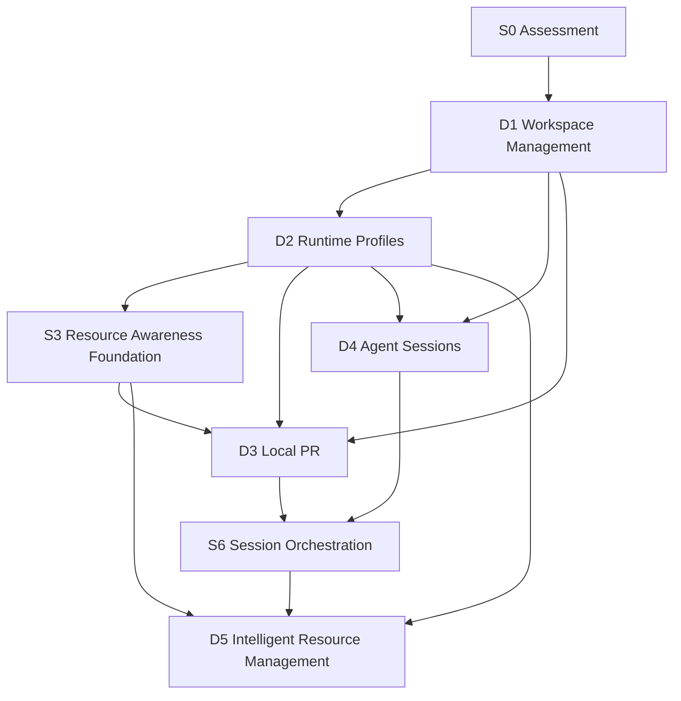
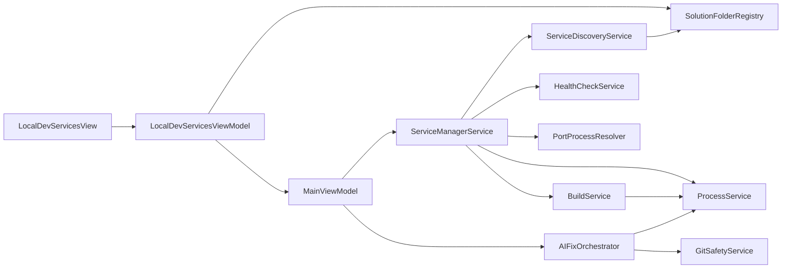
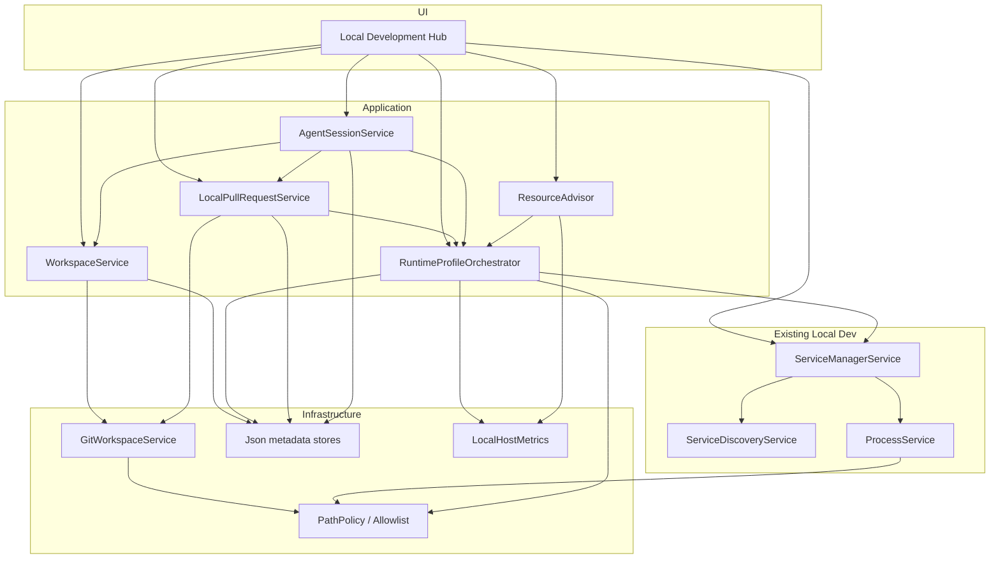

# AOVIAS Studio — Local Development Orchestration
## Dependency Graph (S0)

Assessment HEAD: `9f488ab`

---

## 1. Capability dependency graph (D1–D5)



### Edge rationale

| Edge | Why |
| --- | --- |
| D1 → D2 | Profiles should bind to a workspace/worktree so two agents do not fight the same defaults blindly |
| D1 → D3 | Local PR is branch/worktree relative |
| D1 → D4 | Sessions own a workspace + branch |
| D2 → S3 | Need to know candidate process set before estimating RAM impact |
| D2/S3 → D3 | Validation runs should use profile starts, not Start All |
| D2 → D4 | Optional: session declares active profile |
| D3+D4 → S6 | Orchestration binds review + agent identity + runtime |
| S3+D2 → D5 | Intelligent selection needs metrics + profile catalog |
| S6 → D5 | Best recommendations happen in a full session context |

### Soft vs hard dependencies

| Dependency | Hard? | Notes |
| --- | --- | --- |
| D3 on D2 | Soft | Diff/approval possible earlier; merge validation better with profiles |
| D4 on D2 | Soft | Sessions useful without profiles |
| D5 on S6 | Soft | Heuristics can work from D2+S3 alone |
| D3/D4 on D1 | **Hard** | Without workspace/Git read model, concepts float |

---

## 2. Existing Local Dev internal dependencies (CURRENT)



**Implication:** D2 should hang off `ServiceManagerService` / profile store — not fork a second runner. D1 should **not** be forced through `GitSafetyService`.

---

## 3. Proposed module dependency graph



---

## 4. Implementation sequence graph

```text
S0 ──► S1 (D1)
         │
         ├──────────────► S5 (D4) [after contracts]
         │
         ▼
        S2 (D2)
         │
         ▼
        S3 (resource foundation)
         │
         ├──────────────► S4 (D3)
         │
         ▼
        S6 (session orchestration)
         │
         ▼
        S7 (D5)
```

---

## 5. Shared-file contention graph (parallel agents)

```text
HIGH CONTENTION (serialize)
  ServiceManagerService.cs
  LocalDevServicesView.xaml(+.cs)
  LocalDevServicesViewModel.cs
  MainViewModel.cs (if profile commands added here)
  Any shared IGit* write implementation

MEDIUM
  App.xaml.cs (DI registrations)
  ShellViewModel.cs (nav labels only)

LOW (prefer for parallel work)
  New Services/Workspaces/*
  New Services/RuntimeProfiles/*
  New Services/LocalPr/*
  New Services/AgentSessions/*
  New Services/LocalMetrics/*
  docs / Backups artifacts
```

---

## 6. Data dependency graph

```text
Git worktree (truth)
  └── Workspace record (Studio JSON)
        ├── SolutionFolder association
        │     └── Discovered Service (in-memory + project files)
        │           └── Process binding (runtime)
        ├── RuntimeProfile (Studio JSON)
        │     └── Service references by ProjectPath
        ├── AgentSession (Studio JSON)
        │     ├── Branch name (Git truth)
        │     ├── RuntimeProfileId?
        │     └── LocalPrId?
        └── LocalPR (Studio JSON)
              ├── Source/Target branch (Git truth)
              └── Validation artifacts (Studio files)
```

---

## 7. Security dependency (blocking)

```text
PathPolicy + CommandAllowlist
  must precede
    Git write operations (D3 merge)
    Session automation that launches Cursor CLI
    Any profile action that accepts custom commands
```

Read-only D1 can proceed with **read** Git allowlist only.

---

## 8. Recommended next step

**S1 — D1 Workspace Management**  
Hard prerequisite for coherent D3/D4; lowest-risk first product increment; unlocks parallel design of D2 (Cursor) vs session metadata (either agent) once contracts are published.
